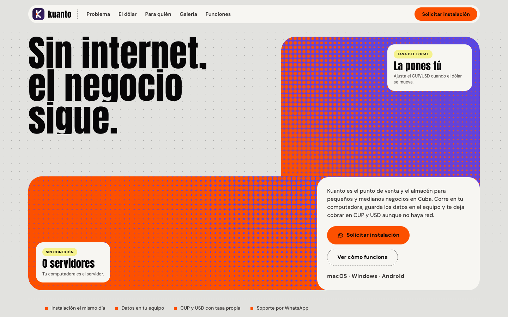

# Kuanto — Landing

Sitio público de **Kuanto**, el punto de venta y almacén **offline-first** para
negocios locales en Cuba. Hecho con **React 19 + TypeScript + Vite 8**, con
prerender estático, SEO completo y build de producción.

**[kuanto.app](https://kuanto.app)** · [Licencia MIT](LICENSE)



> El dominio `kuanto.app` es el asumido por defecto. Si publicas en otro,
> cámbialo en `index.html` (canonical, Open Graph y JSON-LD), `public/robots.txt`
> y `public/sitemap.xml`.

## Arrancar

```bash
cd landing
npm install
npm run dev        # http://localhost:4322
```

## Producción

```bash
npm run build      # typecheck + cliente + SSR + prerender
npm run preview    # sirve dist/ para revisarlo
```

El build hace cuatro pasos:

1. `tsc --noEmit` — comprobación de tipos.
2. `vite build` — cliente en `dist/` con assets hasheados y `public/` copiado.
3. `vite build --ssr src/entry-server.tsx` — bundle de servidor en `dist-ssr/`.
4. `node scripts/prerender.mjs` — inyecta el HTML renderizado (~22 kB) en
   `dist/index.html`. El navegador hidrata encima, así que el contenido existe
   para buscadores y clientes sin JavaScript.

`npm run assets` regenera los iconos PWA y la imagen Open Graph. Solo hay que
ejecutarlo cuando cambie el logo o la marca; necesita Chrome instalado y no forma
parte del build.

### Publicar

Sube el contenido de `dist/` a cualquier hosting estático (Netlify, Vercel,
Cloudflare Pages, S3 + CloudFront, Nginx). Es una sola página con anclas, así que
no hace falta fallback de SPA.

`public/_headers` (Netlify y Cloudflare Pages) aplica:

- `Cache-Control: immutable` a `/assets/*`.
- `max-age=0, must-revalidate` a `index.html`.
- `X-Content-Type-Options`, `Referrer-Policy`, `X-Frame-Options`,
  `Permissions-Policy` y una CSP que solo permite recursos propios y el beacon de
  Cloudflare Web Analytics (`static.cloudflareinsights.com` y
  `cloudflareinsights.com`).

En Vercel u otro host, replica esas cabeceras en su configuración.

### Cloudflare Pages con integración continua

El proyecto de Cloudflare Pages se llama **`kuanto`** (no `kuanto-landing-page`) y
ya está conectado a `carlomonterrey/kuanto-landing-page`. La landing vive en
**https://kuanto.pages.dev**.

Si hay que recrearlo o revisar el build:

1. **Workers & Pages → Create → Pages → Connect to Git**.
2. Autoriza la Cloudflare GitHub App y elige
   `carlomonterrey/kuanto-landing-page`.
3. Configura el build:

| Ajuste | Valor |
|---|---|
| Production branch | `main` |
| Framework preset | None |
| Build command | `npm run build` |
| Build output directory | `dist` |
| Root directory | `/` |
| Environment variable | `NODE_VERSION=22` |

4. **Save and Deploy**. Cada push a `main` reconstruye y publica; cada pull
   request genera una *preview deployment* con su propia URL.

El build incluye typecheck, Vite, SSR y prerender, así que Cloudflare recibe
`dist/` ya con el HTML estático. `public/_headers` se aplica automáticamente
(caché de assets, CSP y cabeceras de seguridad).

**Dominio:** hoy la landing está en `kuanto.pages.dev`. `kuanto.app` sirve otra
app (la de finanzas), así que para el canonical conviene un subdominio
(`pos.kuanto.app` o `landing.kuanto.app`) o mover la app antes de apuntar el
apex. Mientras tanto, el canonical de `index.html` sigue apuntando a
`kuanto.app`: cámbialo cuando se decida el dominio final.

**CI en GitHub:** `.github/workflows/ci.yml` ejecuta `npm ci` y `npm run build`
en cada push y pull request. Es un chequeo, no un segundo despliegue: el deploy
lo hace la integración de Cloudflare. Evita añadir otro workflow que publique,
porque duplicaría despliegues.

**Subida directa (alternativa sin Git):**

```bash
npm run build
npx wrangler pages deploy dist --project-name=kuanto
```

### Checklist de salida

- DNS con HTTPS y redirección de `www` al dominio canónico.
- Buscar `kuanto.app` y sustituirlo por el dominio real (ver abajo).
- Google Search Console: verificar propiedad, enviar `sitemap.xml` y pedir
  indexación de la home.
- Bing Webmaster Tools: importar desde Search Console.
- Rich Results Test sobre la home (SoftwareApplication y FAQPage).
- Facebook Sharing Debugger y WhatsApp: comprobar la tarjeta Open Graph.
- PageSpeed Insights en móvil y escritorio.

## SEO e indexado

- **Metadatos**: título, descripción, canonical, `robots`, `author`,
  `theme-color`, `hreflang` (`es`, `x-default`) y `lang="es"`.
- **Open Graph y Twitter**: título, descripción e imagen 1200×630
  (`/og/kuanto-og.png`) con `og:image:width/height/alt`.
- **Datos estructurados JSON-LD**: `Organization`, `WebSite`,
  `SoftwareApplication` (macOS, Windows, Android, con `featureList`) y `FAQPage`.
  Las cuatro preguntas del FAQ están visibles en la sección «Preguntas
  frecuentes»: si cambias una respuesta en `content.ts`, actualiza también el
  JSON-LD de `index.html`.
- **Rastreo**: `robots.txt` con `Allow: /` y referencia al sitemap;
  `sitemap.xml` con la home y `lastmod`.
- **PWA**: `manifest.webmanifest`, iconos 192/512, maskable y apple-touch.
- **Contenido**: HTML prerenderizado, un solo `h1`, landmarks (`header`, `nav`,
  `main`, `footer`), `alt` en todas las imágenes y jerarquía de encabezados.
- **Rendimiento**: fuentes self-hosted con `preload`, imágenes con
  `width`/`height`, galería con `loading="lazy"`, JS ~77 kB gzip y CSS ~6 kB gzip.

### El dominio

El proyecto asume `https://kuanto.app`. Si el dominio final es otro, cámbialo en:

- `index.html` — canonical, hreflang, `og:url`, `og:image`, `twitter:image` y las
  URLs del JSON-LD.
- `public/robots.txt` — línea del sitemap.
- `public/sitemap.xml` — `<loc>`.

Después, reconstruye y vuelve a enviar el sitemap.

## Dónde tocar cada cosa

| Quiero cambiar… | Archivo |
|---|---|
| Textos, titulares y CTAs | `src/data/content.ts` |
| Capturas de la galería y sus explicaciones | `src/data/gallery.ts` |
| Colores, tipografías, radios y ritmo | `src/styles/tokens.css` |
| Composición y estilos de cada sección | `src/styles/app.css` |
| Orden de las secciones | `src/App.tsx` |
| Número de WhatsApp y mensajes | `src/data/content.ts` (`WHATSAPP_NUMBER`) |
| SEO, Open Graph y JSON-LD | `index.html` |
| Iconos y OG | `npm run assets` |
| Una sección concreta | `src/components/<Seccion>.tsx` |

Todo el copy está separado de los componentes: no hace falta tocar React para
cambiar un texto.

## Estructura

```
landing/
├── index.html              metadatos, JSON-LD, manifest
├── vite.config.ts
├── tsconfig.json
├── package.json
├── public/
│   ├── robots.txt
│   ├── sitemap.xml
│   ├── manifest.webmanifest
│   ├── _headers
│   ├── icons/              PWA y apple-touch
│   └── og/                 imagen Open Graph
├── scripts/
│   ├── generate-assets.mjs iconos + OG
│   └── prerender.mjs       inyecta el HTML estático
└── src/
    ├── main.tsx            hidrata el HTML prerenderizado
    ├── entry-server.tsx    render para el prerender
    ├── App.tsx
    ├── assets/
    ├── components/
    ├── data/
    ├── hooks/
    └── styles/
```

## Secciones

1. **Hero** — titular y la figura de dos bloques halftone con la tarjeta de
   presentación.
2. **Problema** — por qué la red no es una garantía, con un cierre sobre fondo
   negro («Kuanto no promete tiempo real…») que entra línea por línea.
3. **El dólar** — tasa configurable, precios en CUP/USD, márgenes, historial y
   una calculadora interactiva.
4. **Para quién** — titular centrado, botón y cuatro tarjetas Ember con la
   franja de plataformas.
5. **La pregunta** — «¿Cuánto ganas realmente?» / «¿Tú lo sabes?» /
   «Kuanto lo sabe.» con entrada línea por línea.
6. **Lo que no hace** — límites honestos (sin nube, sin tiempo real).
7. **Preguntas frecuentes** — cuatro respuestas visibles que coinciden con el
   `FAQPage` del JSON-LD.
8. **Galería** — las únicas capturas de la página, con explicación y lightbox.
9. **Funcionalidades**, **Cómo funciona**, **Confianza**, **CTA** y **footer**.

## WhatsApp

Todos los CTA abren un chat con el número configurado en
`src/data/content.ts`:

```ts
export const WHATSAPP_NUMBER = '5355230827';
export const WHATSAPP_MESSAGES = {
  install: 'Hola, quiero solicitar la instalación de Kuanto.',
  support: 'Hola, necesito soporte con Kuanto.',
};
```

## Móvil

- Barra fija de WhatsApp que aparece al pasar el hero.
- Hero apilado, galería a una columna y calculadora a ancho completo.
- `scroll-margin-top` para que los anclajes no queden bajo la nav.

## Movimiento

- Entrada del hero con máscaras, `clip-path` y `fadeUp` escalonado.
- `Reveal` con `IntersectionObserver` una sola vez; el cierre del problema y la
  pregunta animan línea por línea.
- Parallax suave en el bloque violeta del hero.
- Todo se desactiva con `prefers-reduced-motion`.

## Pendientes antes de publicar

- Sustituir `kuanto.app` por el dominio real y verificar DNS/HTTPS.
- **Confianza** usa una frase por tipo de cliente, sin cifras ni testimonios
  inventados. No hay logos de clientes en el repositorio.
- El número de WhatsApp está en `content.ts`; confirma que sea el definitivo.
- Las capturas muestran datos de prueba; conviene reemplazarlas por un catálogo
  real.
- El CTA abre WhatsApp; todavía no existe enlace de descarga.
- Analítica: Cloudflare Web Analytics (sin cookies) en `index.html` y conteo
  anónimo de clics de descarga en el Worker. No hay grabaciones de sesión. Si se
  cambia de herramienta, actualiza la CSP de `_headers`.
